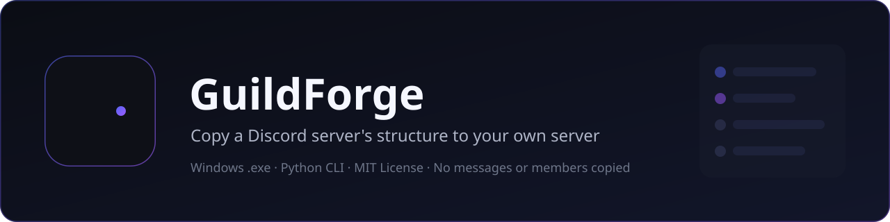
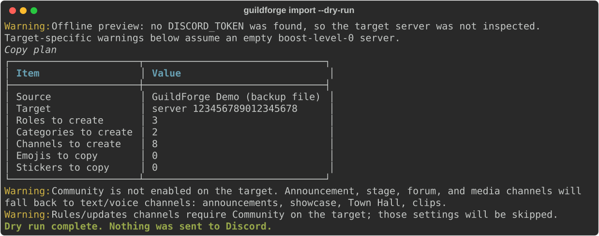

<div align="center">



**Copy a Discord server's structure to your own server in one command.**

[](LICENSE)
[](https://www.python.org/downloads/)
[](https://github.com/Ziadtareks/GuildForge/releases/latest)
[](https://github.com/Ziadtareks/GuildForge/stargazers)
[](https://github.com/Ziadtareks/GuildForge/issues)

### [Download the latest release](https://github.com/Ziadtareks/GuildForge/releases/latest)

</div>

## Download

The easiest way to use GuildForge is the **single-file Windows executable**:

**[Download `GuildForge.exe`](https://github.com/Ziadtareks/GuildForge/releases/latest)** — no Python needed.

1. Download `GuildForge.exe` from the latest release.
2. Put it in a folder where you can create files (for example `C:\GuildForge`).
3. Create a `.env` file next to it with your bot token (`DISCORD_TOKEN=...`), or let GuildForge ask for the token when it starts.
4. Run it from a terminal, or double-click it for a menu.

> Windows is supported by the `.exe`. Linux and macOS users can run GuildForge from source
> (see [Quick start](#quick-start)). Prebuilt Linux/macOS binaries are tracked in
> [issue #4](https://github.com/Ziadtareks/GuildForge/issues/4).

## Contents

- [Demo](#demo)
- [What it does](#what-it-does)
- [What it does not copy](#what-it-does-not-copy)
- [Quick start](#quick-start)
- [Create your bot](#create-your-bot)
- [Usage](#usage)
  - [List your servers](#list-your-servers)
  - [Export a server](#export-a-server)
  - [Import a backup](#import-a-backup)
  - [Clone a server](#clone-a-server)
  - [Dry run](#dry-run)
  - [Resume an interrupted copy](#resume-an-interrupted-copy)
  - [Interactive menu](#interactive-menu)
- [Template mode](#template-mode)
- [Limitations](#limitations)
- [Troubleshooting](#troubleshooting)
- [FAQ](#faq)
- [Security and responsible use](#security-and-responsible-use)
- [Contributing](#contributing)
- [License](#license)

## Demo

This is real output from `guildforge import --dry-run` with the sample backup. No token is
needed for an offline preview, and nothing is sent to Discord.

<p align="center">
  
</p>

## What it does

GuildForge copies the **structure** of one Discord server into another:

- **Server settings** — name, icon, banner and splash (when the target boost level allows),
  description, verification level, default notifications, explicit content filter, AFK channel
  and timeout, system channel, rules channel, public updates channel, and preferred locale.
- **Roles** — name, color, hoist, mentionable, permissions, order, unicode emoji or icon.
- **Categories and channels** — text, voice, announcement, stage, forum, and media channels,
  with names, topics, NSFW flag, slowmode, bitrate, user limit, RTC region, video quality,
  auto-archive duration, forum tags, default reaction, position, and parent category.
- **Permission overwrites** for roles, mapped from the old server's roles to the new ones.
- **Emojis and stickers** — only when you pass `--emojis`.

It can read three kinds of sources:

| Source | How it works |
| --- | --- |
| **Server ID** | The bot must be a member of the source server. |
| **Template link or code** | Uses Discord's public template API; the bot does **not** need to be in the source. |
| **JSON backup** | A file created earlier by `guildforge export`, or written by hand. |

It uses an **official Discord bot token** only. It is not a self-bot and it never uses user tokens.

## What it does not copy

- Messages, threads, or message history.
- Members, bans, or invites.
- Webhooks, integrations, application commands, or bot configurations.
- Member-specific channel permission overwrites (only role overwrites are copied).
- Managed roles (bot roles, integration roles, booster roles).
- Server boosts, and emojis/stickers unless `--emojis` is passed.
- AutoMod rules, events, soundboard sounds, or onboarding settings.

## Quick start

1. **Download** [`GuildForge.exe`](https://github.com/Ziadtareks/GuildForge/releases/latest)
   (Windows), or install from source:

   ```bash
   git clone https://github.com/Ziadtareks/GuildForge.git
   cd GuildForge
   python -m venv .venv
   .venv\Scripts\activate          # Windows
   # source .venv/bin/activate     # Linux / macOS
   pip install -e .
   ```

2. **Create a bot and invite it** to both servers — follow
   [Create your bot](#create-your-bot). Put the bot role at the top of the target server.

3. **Clone:**

   ```powershell
   .\GuildForge.exe clone --source 111111111111111111 --target 222222222222222222
   ```

   Add `--dry-run` first to preview the plan without changing anything.

Python **3.10 or newer** is required for the source install.

## Create your bot

### 1. Create the application and bot

1. Open the [Discord Developer Portal](https://discord.com/developers/applications) and click **New Application**.
2. Name it (for example `GuildForge`) and create it.
3. Open the **Bot** tab, click **Reset Token**, and copy the token.
4. Save it in a `.env` file next to the executable (or in the project root):

   ```dotenv
   DISCORD_TOKEN=your-bot-token-here
   ```

   GuildForge never prints, logs, or saves the token. `.env` is already in `.gitignore`.

5. Privileged intents are **not required**. GuildForge only needs the standard `GUILDS`
   intent, which every bot has. You do not need Message Content, Server Members, or Presence.

### 2. Invite the bot

Open this URL and replace `YOUR_APPLICATION_ID` with the Application ID from the
**General Information** tab:

```text
https://discord.com/oauth2/authorize?client_id=YOUR_APPLICATION_ID&permissions=8&scope=bot
```

`permissions=8` is **Administrator**, the simplest option. If you prefer narrower permissions,
invite with these instead:

| Permission | Used for |
| --- | --- |
| Manage Server | Server name, icon, banner, splash, and other settings. |
| Manage Roles | Creating and editing roles and role overwrites. |
| Manage Channels | Creating and editing categories and channels. |
| Manage Expressions | Copying emojis and stickers (`--emojis`). |

### 3. Put the bot role on top

In the **target** server: **Server Settings > Roles**, drag the bot's role above all roles it
must create or edit. Discord does not let a bot manage roles that sit above its own highest role.
GuildForge warns you when this is a problem.

### 4. Find a server ID

1. **User Settings > Advanced > Developer Mode**: turn it on.
2. Right-click a server icon and choose **Copy Server ID** (17–20 digits).

### 5. Notes for Community and boost features

Announcement, stage, forum, and media channels, plus rules/updates channels, need **Community**
enabled on the target server. Banners need boost level 2; invite splashes need boost level 1.
When a feature is not available, GuildForge warns and skips or falls back. It does not crash.

## Usage

```text
guildforge export --source <id|template> --out backup.json
guildforge import --file backup.json --target <guildId>
guildforge clone  --source <id|template> --target <guildId>
guildforge list
guildforge --version
```

| Flag | Used by | Meaning |
| --- | --- | --- |
| `--dry-run` | `clone`, `import` | Check everything and print the plan without writing to Discord. |
| `--clear-target` | `clone`, `import` | Delete target channels and non-managed roles first. You must type the server name to confirm. |
| `--emojis` | `export`, `clone`, `import` | Also copy emojis and stickers (off by default). |
| `--yes` | all | Skip confirmation prompts. Use with care. |
| `--verbose` | all | Show detailed progress and full errors. |

### List your servers

```console
$ guildforge list
```

Prints a table with each server's name, ID, member count, and owner. Use it to find the IDs
you need for `clone`, `export`, and `import`.

### Export a server

```console
$ guildforge export --source 100000000000000001 --out backup.json
```

GuildForge writes a readable JSON backup (`schema_version: 1`) and prints a summary of the
roles, categories, channels, emojis, and stickers it saved. Add `--emojis` to include emojis
and stickers. If the output file already exists, GuildForge asks before overwriting it
(pass `--yes` to skip the question).

Template sources work too:

```console
$ guildforge export --source https://discord.new/abc123XYZ --out backup.json
```

Templates contain channels, roles, and overwrites, but not server settings, icons, banners,
emojis, or stickers. GuildForge tells you this after reading a template.

### Import a backup

```console
$ guildforge import --file backup.json --target 222222222222222222
```

You can edit the JSON first: remove roles or channels you do not want, or change names and
topics. The import validates the file before writing anything.

### Clone a server

```console
$ guildforge clone --source 111111111111111111 --target 222222222222222222
```

GuildForge shows a plan, asks for confirmation, then copies the structure and prints a report
with created, skipped, and failed counts. Warnings are listed at the end.

Useful variants:

```powershell
guildforge clone --source 111111111111111111 --target 222222222222222222 --dry-run
guildforge clone --source https://discord.new/abc123XYZ --target 222222222222222222
guildforge clone --source backup.json --target 222222222222222222 --clear-target --emojis
```

`--clear-target` is destructive: it deletes channels and non-managed roles in the target
before copying. GuildForge asks you to type the target server's name unless you pass `--yes`.

### Dry run

A real offline preview with the included sample backup:

```console
$ guildforge import --file examples/sample_backup.json --target 123456789012345678 --dry-run
Warning: Offline preview: no DISCORD_TOKEN was found, so the target server was not inspected.
Target-specific warnings below assume an empty boost-level-0 server.
                       Copy plan
+------------------------------------------------------+
| Item                 | Value                         |
|----------------------+-------------------------------|
| Source               | GuildForge Demo (backup file) |
| Target               | server 123456789012345678     |
| Roles to create      | 3                             |
| Categories to create | 2                             |
| Channels to create   | 8                             |
| Emojis to copy       | 0                             |
| Stickers to copy     | 0                             |
+------------------------------------------------------+
Warning: Community is not enabled on the target. Announcement, stage, forum, and media channels
will fall back to text/voice channels: announcements, showcase, Town Hall, clips.
Warning: Rules/updates channels require Community on the target; those settings will be skipped.
Dry run complete. Nothing was sent to Discord.
```

With a token, the preview also inspects the target server: its name, your permissions, its
boost level, and Discord's limits.

### Resume an interrupted copy

Progress is saved to `.guildforge-state.json` after every role, channel, and emoji. If a run
is interrupted (error, crash, or `Ctrl+C`), run the same command again. GuildForge offers to
continue where it stopped instead of creating duplicates. Delete the state file to start fresh.

### Interactive menu

Run `GuildForge.exe` with no arguments (or double-click it) to get an arrow-key menu:
Clone, Export, Import, List, or Exit. It shows a short explanation of each choice and asks for
the values it needs.

## Template mode

Discord templates are an official way to share a server layout. GuildForge reads them with
the public template API, so the bot only needs to be in the **target** server.

```powershell
guildforge clone --source https://discord.new/abc123XYZ --target 222222222222222222
```

Template limits:

- No server settings. The template provides the server name, roles, channels, and overwrites,
  but not icons, banners, splashes, descriptions, locales, verification levels, or notifications.
- No emojis or stickers.
- Templates can expire. If one is gone, GuildForge reports a clear error.

For a full copy, add the bot to the source server and use its server ID.

## Limitations

- Discord's hard limits apply: **250 roles**, **500 channels**, **50 channels per category**,
  and emoji/sticker slots based on the target's boost level. GuildForge checks these before writing.
- A bot can only manage roles **below its own top role**. Put the bot role at the top.
- Managed roles (bots, integrations, boosters) are never created or deleted.
- Member-specific permission overwrites are skipped on purpose.
- Messages, threads, members, webhooks, integrations, AutoMod, events, and onboarding are not copied.
- Community-only channel types fall back on targets without Community. Banners, splashes, and
  higher emoji limits need the matching boost level.
- Lottie stickers cannot be created by bots and are skipped with a warning.
- Forum tags and default reactions that reference custom emoji can fall back or be skipped,
  because source emoji IDs do not exist on the target.
- On a non-empty target, copied positions can shift existing items. Use `--clear-target` for an
  exact layout.
- A few server setting changes are rate-limited by Discord and can take a moment to appear.

## Troubleshooting

**"Discord rejected the bot token"**
Re-copy the token from **Developer Portal > Bot > Reset Token**. Use a bot token (three
dot-separated parts), not a client secret or a user token. Update `.env`.

**"The bot cannot access the target server"**
The bot is not in that server, the ID is wrong, or the invite was removed. Re-invite the bot
using the link above.

**"The bot does not have Administrator permission"**
In the target server, open **Server Settings > Roles > (bot role)** and enable
**Administrator**, then rerun.

**Role creation fails or roles are out of order**
Move the bot role to the top of **Server Settings > Roles**. Then rerun; GuildForge resumes
and does not duplicate what it already created.

**Announcement/forum/stage channels became text/voice channels**
Enable **Community** on the target: **Server Settings > Enable Community**.

**Banner or invite splash was skipped**
Banners need boost level 2; splashes need level 1. GuildForge skips them with a warning.

**Emojis or stickers were not copied**
Pass `--emojis`. Slots depend on the target's boost level, and Lottie stickers cannot be
created by bots.

**The run says some steps failed**
The final report lists each failure. Fix the cause (usually permissions or role position) and
run the same command again. GuildForge resumes from the saved state file.

## FAQ

**Is GuildForge allowed by Discord?**
It uses the official bot API. Copying a server you own, or that you have permission to copy,
is fine. Do not clone servers you do not own or have rights to.

**Why a bot token and not a login?**
Discord does not allow tools to log in with an account. User tokens are against Discord's
Terms of Service and can get your account banned. OAuth2 login is not a solution either: it
cannot create roles or channels. A bot token is the only supported way to create and edit
server structure.

**Does the bot need to be in the source server?**
Only for server ID sources. With a template link or code, the bot just needs to be in the target.

**Can I undo a clone?**
Not automatically. Use `--dry-run` first, and export the target before changing it. `--clear-target`
is destructive and asks you to type the server name.

**Windows says the `.exe` has a virus.**
PyInstaller executables are often flagged as false positives. Download only from the official
[Releases](https://github.com/Ziadtareks/GuildForge/releases) page and verify the SHA256
checksum in the release notes, or run from source with `pip install -e .`.

**Where is the resume file?**
`.guildforge-state.json` in the folder where you ran the command. Delete it to start clean.

**Can I copy only part of a server?**
Export it, edit the JSON (remove roles/channels), then import or clone from that file. The
backup format is plain JSON with a `schema_version` field.

**Do I need the Message Content intent?**
No. GuildForge never reads messages.

**Does it copy emojis or stickers by default?**
No. They are opt-in with `--emojis`.

## Security and responsible use

- **Only copy servers you own or have explicit permission to copy.**
- **Bot tokens only.** Never use a user token or a self-bot. Rotate your token immediately if
  you paste it into a chat, screenshot, or issue.
- **Token safety.** GuildForge reads the token from `.env`, the environment, or hidden input.
  It never prints it, logs it, or writes it to disk. Log output is redacted.
- **Backups are sensitive.** A backup contains role names, channel names, topics, and permission
  structures. Treat it like configuration data.
- **Dry run first.** `--dry-run` shows every planned change, including deletions.
- **Rate limits.** GuildForge respects Discord's limits and retries 429/5xx responses with
  backoff. Avoid running several copies against the same server at once.
- GuildForge is unofficial and not affiliated with Discord Inc. You are responsible for
  following Discord's Terms of Service and Community Guidelines.

## Contributing

Contributions are welcome. Please read [CONTRIBUTING.md](CONTRIBUTING.md) and
[CODE_OF_CONDUCT.md](CODE_OF_CONDUCT.md) first. Security reports go through
[SECURITY.md](SECURITY.md).

```bash
pip install -e ".[dev]"
ruff check .
ruff format --check .
pytest
```

See [docs/MANUAL_TEST.md](docs/MANUAL_TEST.md) for the real-server test checklist, and
[the open issues](https://github.com/Ziadtareks/GuildForge/issues) for good first tasks.

## License

[MIT](LICENSE) © 2026 Ziad Tarek
